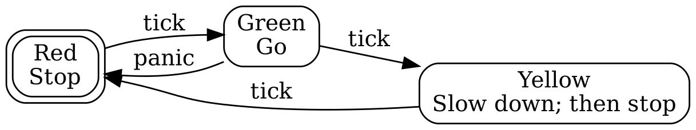
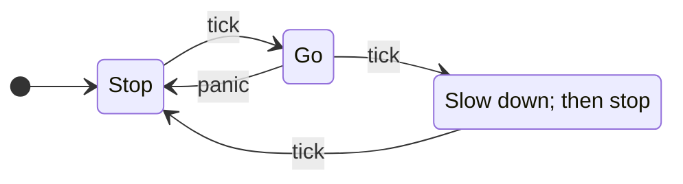

# Step 3: visualize — two target languages, one walk

## What it shows
Two visitors on the `Visitor` base of step 2, both producing a picture of the *machine*
(as opposed to textX's built-in `--target dot`, which draws the *model*: every object a
box, every attribute an edge — useful for debugging a grammar, useless for the user of the
language):

* `DotVisitor` — the DOT language for Graphviz. The grammar is now Topic 5's step 4, with
  labels, so three decisions textX cannot make are visible in the code: a label goes
  *inside* the node, `initial` is a double border (`peripheries=2`), a transition is an
  arrow carrying its event. Rounded boxes instead of circles because a long label makes a
  circle enormous — a design choice, not a rule.
* `MermaidVisitor` — a Mermaid `stateDiagram-v2`. GitHub renders it inside a Markdown
  file with nothing installed, which is why the homework asks for Mermaid rather than DOT.
  It costs the same handful of lines as DOT: the walk is shared, only the strings differ.

`Emitter` is `Visitor` plus an `out` method and a list of lines — the shape every
text-producing visitor in this topic has.

### The lesson hidden in the second target: escaping
`Slow down; then stop` is a legal label in our language. In DOT it needs the quote and
the newline escaped (`dot_string`). In Mermaid a `"` inside a quoted label ends the label
— the parser reports `Expecting 'AS', got 'COMPOSIT_STATE'` and draws nothing — and a `;`
in a transition's `: description` ends the description, silently cutting the text off.
Mermaid takes HTML-style entity codes instead (`#quot;`, `#59;`), so `mermaid_text`
replaces both characters wherever model text goes into the diagram: one rule, no
case analysis about which position tolerates what. A generator writes text in *another*
language and must respect that language's rules for strings, not just its own: every place where model text lands inside
target text goes through a function named after the target. Step 5 does it a third time
for C.

One more thing the semicolon teaches: **the order of the replacements matters**. `#quot;`
ends in a semicolon, so escaping `"` first and `;` second turns a quote into `#quot#59;`.
`mermaid_text` therefore replaces `;` first. (The traffic light's labels contain no quote,
so this file would have hidden the bug; the homework's tests found it.)

## Files
* [`fsm.tx`](fsm.tx) — Topic 5 step 4: `label=STRING`, `Duration`, comments;
* [`light.fsm`](light.fsm) — the light with labels and timeouts;
* [`visualize.py`](visualize.py) — `Visitor`, `Emitter`, `DotVisitor`, `MermaidVisitor`, `dot_string`, `mermaid_text`;
* `light.dot`, [`light.mmd`](light.mmd) — written by the script. `light.mmd` is committed; `.dot` files are git-ignored in this repository (the PNG is the committed fallback), so run the script once before rendering;
* [`light.png`](light.png), [`light-mermaid.png`](light-mermaid.png) — the two renderings.

## Run
```shell
uv run python topic-7/examples/step-3-visualize/visualize.py
```
writes `light.dot` and `light.mmd` next to itself and prints both:
```
=== light.dot
digraph Light {
  rankdir=LR;
  node [shape=box, style=rounded];
  Red [label="Red\nStop", peripheries=2];
  Red -> Green [label="tick"];
  Green [label="Green\nGo"];
  Green -> Yellow [label="tick"];
  Green -> Red [label="panic"];
  Yellow [label="Yellow\nSlow down; then stop"];
  Yellow -> Red [label="tick"];
}

=== light.mmd
stateDiagram-v2
    direction LR
    [*] --> Red
    state "Stop" as Red
    Red --> Green : tick
    state "Go" as Green
    Green --> Yellow : tick
    Green --> Red : panic
    state "Slow down#59; then stop" as Yellow
    Yellow --> Red : tick
render: dot -Tpng -Gdpi=200 light.dot -o light.png
        mmdc -i light.mmd -o light-mermaid.png -t neutral -s 3
```
Render them (Graphviz: `dot -V`; Mermaid CLI: `npm install -g @mermaid-js/mermaid-cli`):
```shell
cd topic-7/examples/step-3-visualize
dot -Tpng -Gdpi=200 light.dot -o light.png
mmdc -i light.mmd -o light-mermaid.png -t neutral -s 3
```


The Mermaid text, pasted into this README as a fenced `mermaid` block, is rendered by
GitHub itself — this is what the homework's README must contain:


